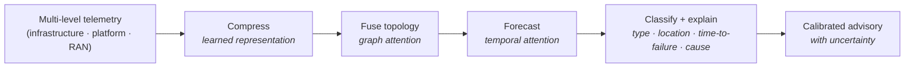

# autofm - Autonomous Fault Management

### Predict network faults before they cause outages.

`autofm` forecasts faults in 5G NR (Open RAN) networks *before they happen*, so
operators can act ahead of impact. It reads multi-level telemetry across the
deployment - infrastructure, platform, and RAN - learns how a fault builds up,
and raises a calibrated advisory that says **what** will fail, **where**,
**when**, **why**, and **what to do**.

> Built at the **European AI Hackathon 2026** by team **AFM_Ericsson**.

---

## Why autofm

Conventional monitoring watches one level and reacts after the outage. `autofm`
watches every level and predicts the fault before it lands.

| | Conventional monitoring | **autofm** |
|---|-------------------------|------------|
| **Timing** | Reactive - fires after the fault | **Predictive** - advisory ahead of impact |
| **Scope** | Single level (radio *or* host) | **Multi-level** - infra + platform + RAN fused |
| **Output** | "An alarm occurred" | **What / where / when / why / action** |
| **Trust** | Binary alarm | **Calibrated uncertainty + coverage guarantee** |
| **Explainability** | Operator investigates | **Causal chain** from graph attention |
| **Scale** | Per-site rule tuning | **GPU-accelerated** across the fleet (4× A100, DDP) |

---

## Table of contents

- [The problem](#the-problem)
- [How it works](#how-it-works)
- [Documents](#documents)
- [Hackathon goals](#hackathon-goals)
- [Team](#team)
- [Status](#status)
- [License](#license)

---

## The problem

In a virtualized O-RAN deployment a single fault surfaces across levels at once:

- **Infrastructure** - the host (CPU, memory, temperature, power)
- **Platform** - the network-function containers (CU, DU)
- **RAN** - the cells, carriers, and user-plane transport

**Watch only one level and you misdiagnose.** A RAN symptom (packet loss, rising
latency) can look like a radio problem when the real cause is a host CPU
throttling under a thermal spike. Reactive, single-level monitoring names the
wrong culprit - and only after the outage.

## How it works

`autofm` reads multi-level telemetry and runs it through a pipeline that
**compresses, fuses topology, forecasts, then classifies** the network state
into a calibrated fault advisory:

Every prediction carries an uncertainty estimate and a distribution-free
coverage guarantee, so operators know when to trust it - and the graph-attention
weights trace the causal chain that explains *why*. Training is GPU-accelerated
and scales across 4× A100 via PyTorch DDP, with throughput measured end to end.

The architecture, model, and dataset are specified in detail under
[`docs/`](docs/) - start with
[`docs/SYSTEM_DESIGN.md`](docs/SYSTEM_DESIGN.md).

## Documents

| Document | What it covers |
|----------|----------------|
| [`docs/SYSTEM_DESIGN.md`](docs/SYSTEM_DESIGN.md) | System architecture, model, FM/PM/CM scope, evaluation |
| [`docs/ARCHITECTURE.md`](docs/ARCHITECTURE.md) | C4 architecture views (context, container, component, dynamic, deployment) and quality attributes |
| [`docs/DATASET_SPEC.md`](docs/DATASET_SPEC.md) | Dataset overview - what the multi-level dataset is and why it matters (short) |
| [`docs/DATASET_REFERENCE.md`](docs/DATASET_REFERENCE.md) | Full dataset reference: schema, topology, labels, loader + ML pipeline contract |
| [`docs/TEAM.md`](docs/TEAM.md) | Team and event |

## Hackathon goals

1. **Predict** multi-level O-RAN faults end to end - type, location, lead time,
   cause, and recommended action.
2. **GPU-accelerate** training with mixed precision and scale across 4× A100 via
   PyTorch DDP.
3. **Benchmark and profile** throughput (Nsight) and report multi-GPU scaling
   efficiency toward production-scale counter volumes.

## Team

Team **AFM_Ericsson** - see [`docs/TEAM.md`](docs/TEAM.md).

## Status

🚧 Early development - hackathon project.

## Disclaimer

`autofm` is an independent project developed by the authors for the European AI
Hackathon 2026. It is **not** an official Ericsson product and is **not** endorsed
by or affiliated with Ericsson. Team members' employer is listed for professional
background only.

## License

[Apache License 2.0](LICENSE)
