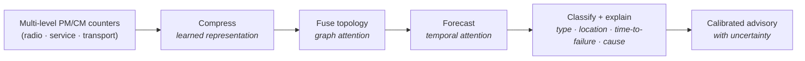

# autofm - Autonomous Fault Management

### Predict network faults before they cause outages.

`autofm` forecasts faults in 5G NR (Open RAN) networks *before they happen*, so
operators can act ahead of impact. It reads standard PM/CM counters across the
RAN, learns how a fault builds up, and raises an advisory that says **what** will
fail, **where**, **when**, **why**, and **what to do**.

> Built at the **European AI Hackathon 2026** by team **AFM_Ericsson**.

---

## Table of contents

- [The problem](#the-problem)
- [How it works](#how-it-works)
- [Documents](#documents)
- [Hackathon goals](#hackathon-goals)
- [Team](#team)
- [Status](#status)
- [License](#license)

---

## The problem

A single fault in a disaggregated RAN shows up at several levels at once:

- **Radio** - the cell and carrier (NRCellDU, NRSectorCarrier)
- **Service** - the centralized unit (NRCellCU: mobility, accessibility)
- **Transport** - the user-plane links under the CU-UP

**Watch only one level and you misdiagnose.** A transport packet-loss fault can
look like a radio problem, when the real cause is a degrading user-plane link.
Reactive, single-level monitoring names the wrong culprit - and only after the
outage.

## How it works

`autofm` reads multi-level PM/CM counters and runs them through a pipeline that
**compresses, forecasts, then classifies** the network state into a fault
advisory:

Each prediction carries an uncertainty estimate and a calibrated confidence, so
operators know when to trust it. A simpler baseline pipeline (`falcon`) is kept
alongside for comparison.

The architecture and the dataset are specified in detail under
[`docs/`](docs/).

## Documents

| Document | What it covers |
|----------|----------------|
| [`docs/SYSTEM_DESIGN.md`](docs/SYSTEM_DESIGN.md) | System architecture, model, FM/PM/CM scope, evaluation |
| [`docs/DATASET_SPEC.md`](docs/DATASET_SPEC.md) | PM/CM dataset schema, topology, fault model, labels, ML pipeline contract |
| [`docs/TEAM.md`](docs/TEAM.md) | Team and event |

## Hackathon goals

1. **Build** the fault-prediction pipeline end to end.
2. **GPU-accelerate** training and inference.
3. **Benchmark and scale** toward production-scale counter volumes.

## Team

Team **AFM_Ericsson** - see [`docs/TEAM.md`](docs/TEAM.md).

## Status

🚧 Early development - hackathon project.

## Disclaimer

`autofm` is an independent project developed by the authors for the European AI
Hackathon 2026. It is **not** an official Ericsson product and is **not** endorsed
by or affiliated with Ericsson. Team members' employer is listed for professional
background only.

## License

[Apache License 2.0](LICENSE)
