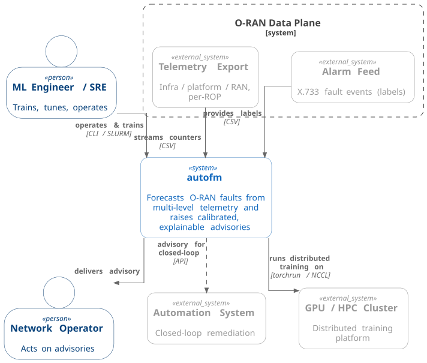
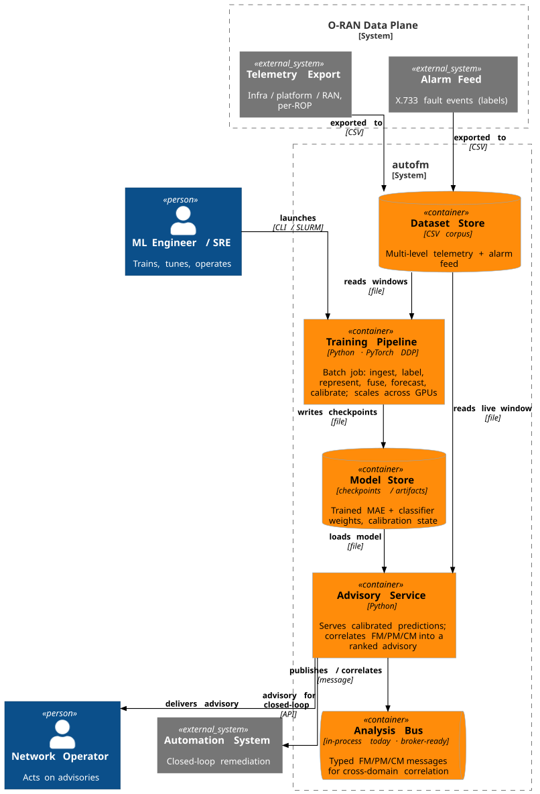
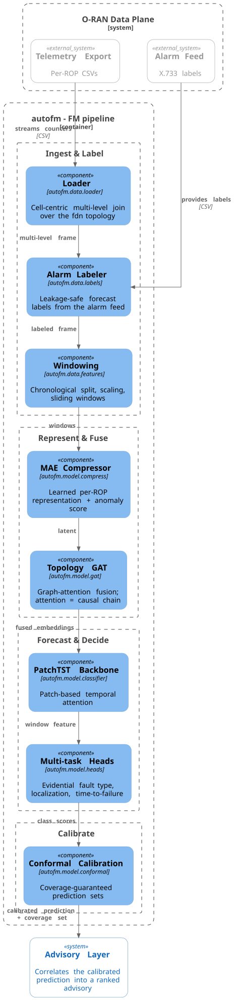
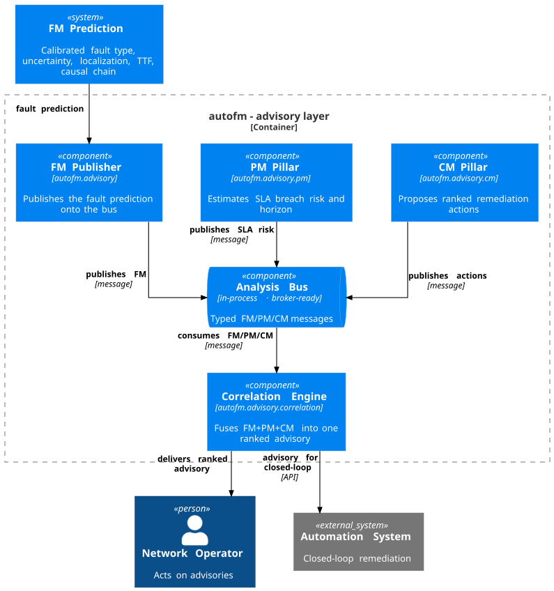
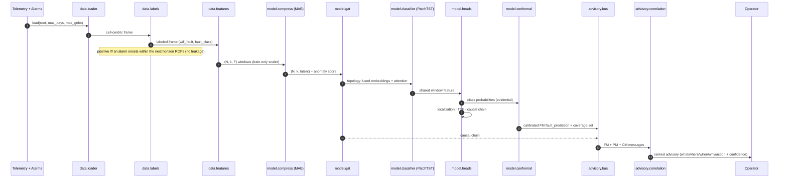
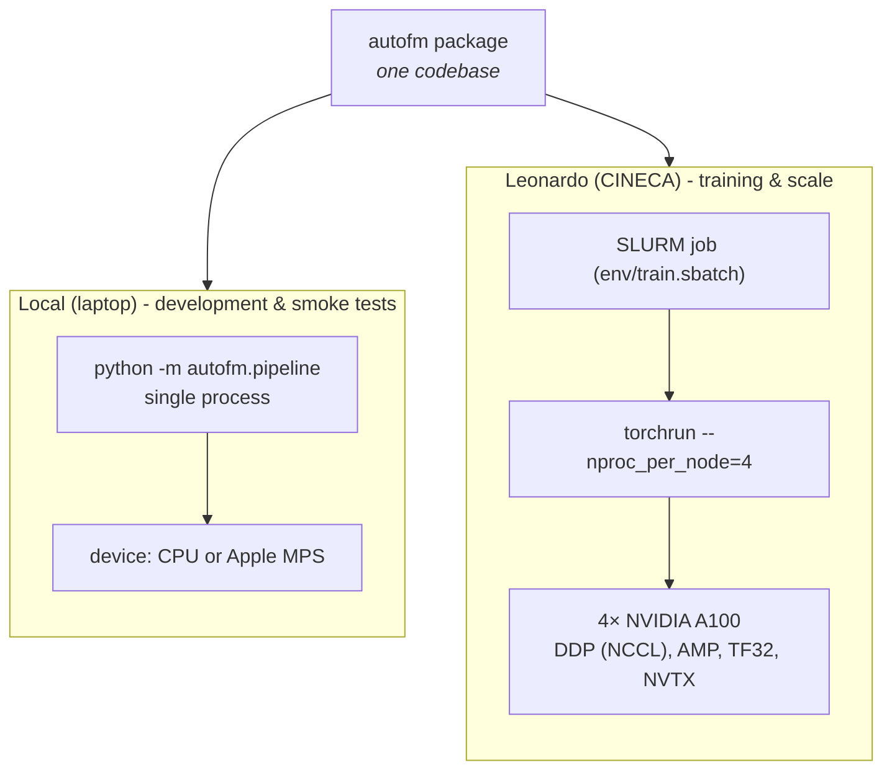

# autofm - Architecture (C4)

**Autonomous Fault Management for 5G Open RAN**

Team AFM_Ericsson · European AI Hackathon 2026

---

This document describes the `autofm` architecture using the
[C4 model](https://c4model.com/) - four zoom levels from system context down to
components, plus a dynamic runtime view, a deployment view, and the quality
attributes the design delivers. Every component maps to a module under
[`autofm/`](../autofm).

The architecture is shaped by four goals, which recur through the views below:

| Goal | How the architecture serves it |
|------|--------------------------------|
| **Predictive** | A forecast-labeling data path and temporal backbone predict faults ahead of impact, not after. |
| **Multi-level** | A cell-centric loader fuses infrastructure, platform, and RAN telemetry through the `fdn` topology. |
| **Trustworthy** | Evidential uncertainty and conformal calibration are first-class stages, not afterthoughts. |
| **GPU-scalable** | One codebase runs on a laptop and scales to 4× A100 via DDP, with throughput measured, not assumed. |

For the problem framing, model rationale, and evaluation plan, see
[`SYSTEM_DESIGN.md`](SYSTEM_DESIGN.md). For the data schema and the ML pipeline
contract, see [`DATASET_REFERENCE.md`](DATASET_REFERENCE.md) (overview in
[`DATASET_SPEC.md`](DATASET_SPEC.md)).

---

## Table of contents

1. [Level 1 - System Context](#1-level-1---system-context)
2. [Level 2 - Container](#2-level-2---container)
3. [Level 3 - Component (FM pipeline)](#3-level-3---component-fm-pipeline)
4. [Level 3 - Component (Advisory layer)](#4-level-3---component-advisory-layer)
5. [Dynamic view - inference & advisory flow](#5-dynamic-view---inference--advisory-flow)
6. [Deployment view](#6-deployment-view)
7. [Quality attributes](#7-quality-attributes)

---

## 1. Level 1 - System Context

`autofm` reads multi-level O-RAN telemetry and an X.733 alarm feed, and produces
a ranked, calibrated fault advisory for a network operator - what will fail,
where, when, why, and what to do.

Diagram source: [`diagrams/01-context.puml`](diagrams/01-context.puml) · rendered via C4-PlantUML (see [`diagrams/README.md`](diagrams/README.md)).

| Element | Role |
|---------|------|
| **Network Operator** | Human actor; acts on the advisory (what / where / when / why / action). |
| **autofm** | Forecasts faults from multi-level telemetry; raises calibrated, explainable advisories. |
| **Telemetry Export** | Per-ROP (15-min) CSVs across three levels - infrastructure, platform, RAN. |
| **Alarm Feed** | X.733 `alarms.csv`; the label source only - never a model feature. |
| **GPU Cluster** | Distributed training and benchmarking on an HPC/SLURM cluster (see the deployment view, [§6](#6-deployment-view)). |
| **Automation System** | Upstream/agentic consumer that acts on the advisory in a closed loop. |

The alarm feed supplies **labels only**, so the task is genuine prediction, not
detection (see [§3](#3-level-3---component-fm-pipeline)).

---

## 2. Level 2 - Container

Zooming into `autofm`. In C4 terms a "container" is a separately-runnable unit.
`autofm` is a single Python package with distinct entry points (each a
`python -m autofm.*` module), over three internal libraries (`data`, `model`,
`advisory`) plus shared single-module utilities (`fdn`, `metrics`).

Diagram source: [`diagrams/02-container.puml`](diagrams/02-container.puml) · rendered via C4-PlantUML (see [`diagrams/README.md`](diagrams/README.md)).

| Container / library | Module | Responsibility |
|---------------------|--------|----------------|
| FM Pipeline | `autofm/pipeline.py` | Orchestrates the end-to-end chain and reports the evaluation bundle. |
| Representation Trainer | `autofm/train_mae.py` | DDP masked-autoencoder training with CUDA preflight checks; laptop single-process fallback. |
| Benchmark & Scaling | `autofm/bench.py` | Measures training throughput (median step time); produces a scaling-efficiency chart. |
| Dataset Profiler | `autofm/profile_dataset.py` | Generates [`DATA_NOTES.md`](DATA_NOTES.md) and a machine-readable profile. |
| `data` library | `autofm/data/`, `autofm/fdn.py` | Multi-level load, alarm labeling, leakage-safe windowing, fdn topology. |
| `model` library | `autofm/model/` | MAE compression, topology GAT, PatchTST backbone, multi-task evidential heads, conformal calibration. |
| `advisory` library | `autofm/advisory/` | Analysis Bus, PM/CM pillars, correlation engine. |
| `metrics` | `autofm/metrics.py` | Multi-class + binary-fault metric bundle. |

---

## 3. Level 3 - Component (FM pipeline)

The FM pipeline is the core of the system. It compresses multi-level telemetry
into a learned representation, fuses it across the network topology, forecasts
its trajectory, and classifies the result into a calibrated, explainable fault
advisory. Each box is a module/class; the data shape flowing between stages is
annotated.

Diagram source: [`diagrams/03-component-fm.puml`](diagrams/03-component-fm.puml) · rendered via C4-PlantUML (see [`diagrams/README.md`](diagrams/README.md)).

The canonical flow is `loader -> labeler -> features -> compress -> GAT ->
PatchTST -> multi-task heads -> conformal -> advisory`. The MAE compressor and
GAT provide a topology-aware representation; the PatchTST backbone models its
temporal trajectory; the multi-task evidential heads produce fault type (with
uncertainty), origin localization, time-to-failure, and the causal chain;
conformal calibration turns the class scores into coverage-guaranteed sets. See
[`SYSTEM_DESIGN.md` §3](SYSTEM_DESIGN.md#3-the-autofm-approach) and
[§6](SYSTEM_DESIGN.md#6-model-architecture) for the model rationale.

### Stage contract

| # | Stage | Input | Output | Module |
|---|-------|-------|--------|--------|
| 1 | Load | dataset root | `LoadedData(frame, feature_cols, timestamps)` | `data.loader.load` |
| 2 | Label | frame + alarms | frame + `will_fault`, `fault_class` | `data.labels.label_frame` |
| 3 | Window / split | labeled frame | `Prepared(train/val/test, mean, std)` | `data.features.prepare` |
| 4 | Compress | `(N, k, F)` | `(N, k, latent)` + anomaly score | `model.compress` |
| 5 | Fuse topology | `(N, k, latent)` + graph | topology-fused embeddings + attention | `model.gat.TopologyGAT` |
| 6 | Forecast | fused embeddings | shared window feature | `model.classifier` (PatchTST) |
| 7 | Predict | window feature | type + uncertainty, localization, TTF, causal chain | `model.classifier` + `model.heads` |
| 8 | Calibrate | class probabilities | 95% coverage set | `model.conformal` |

---

## 4. Level 3 - Component (Advisory layer)

The advisory layer implements the design in [`SYSTEM_DESIGN.md`
§7](SYSTEM_DESIGN.md#7-fm--pm--cm-and-the-analysis-bus): the three management
pillars publish structured outputs to a shared Analysis Bus, and a correlation
engine fuses them into one ranked advisory answering *what / where / when / why
/ action* with a combined confidence.

Diagram source: [`diagrams/04-component-advisory.puml`](diagrams/04-component-advisory.puml) · rendered via C4-PlantUML (see [`diagrams/README.md`](diagrams/README.md)).

The FM prediction is published to the bus; the PM and CM pillars read it and
publish their own assessments; the correlation engine consumes all three and
links the predicted fault to the SLA risk it drives and the remediation that
best resolves both.

---

## 5. Dynamic view - inference & advisory flow

A runtime sequence for a single prediction, from a raw telemetry window to the
advisory an operator sees.

---

## 6. Deployment view

The same codebase runs unchanged across two very different targets; device
selection is runtime (`cuda` -> `mps` -> `cpu`) and CUDA-only features (AMP,
TF32, NVTX, pinned memory, NCCL/DDP) are gated so a laptop path never touches
them.

| Aspect | Local | Leonardo |
|--------|-------|----------|
| Launch | `python -m autofm.pipeline` | `sbatch` + `torchrun` |
| Device | CPU / MPS | 4× A100 (CUDA) |
| Parallelism | single process | DDP (NCCL) |
| Mixed precision | off (gated) | AMP + TF32 |
| Config | `config_autofm.yaml` | `config_leonardo.yaml` |

See [`ENVIRONMENT_SETUP.md`](ENVIRONMENT_SETUP.md) and
[`PROFILING.md`](PROFILING.md) for the operational detail.

---

## 7. Quality attributes

The architectural decisions below are what make `autofm` trustworthy, portable,
and ready to scale - each tied to the mechanism in code that delivers it.

| Attribute | How the architecture achieves it |
|-----------|----------------------------------|
| **No label leakage** | Alarm feed is label-only, never a feature; forecast window `(t, t+horizon]` excludes already-firing alarms; chronological split with train-only scaler; windows never cross a cell boundary. (`data.labels`, `data.features`) |
| **Explainability** | Multi-task heads name the fault type, origin node, and time-to-failure; GAT attention is read as the causal chain - the "why" behind each prediction. (`model.gat`, `model.heads`) |
| **Calibrated confidence** | Evidential heads yield per-prediction uncertainty; conformal calibration produces coverage-guaranteed prediction sets. (`model.evidential`, `model.conformal`) |
| **Portability** | Runtime device selection and CUDA-feature gating let one codebase run on CPU/MPS laptops and A100 clusters unchanged. (`model.compress`, `train_mae`) |
| **Graceful degradation** | Optional heavy dependencies have hand-written fallbacks: GAT falls back from PyG to dense attention; conformal falls back from MAPIE to numpy LAC. The program never fails on a missing optional dependency. (`model.gat`, `model.conformal`) |
| **Single source of truth** | `fdn` parsing lives in one module consumed by loader, labeler, and profiler, so topology logic cannot drift. (`autofm.fdn`) |
| **Swappable components** | One interface per stage (`fit`/`transform` compressors; backbone × head classifier) lets each component be measured against a baseline. (`model.compress`, `model.classifier`) |
| **Scalability** | DDP-capable training with per-rank throughput aggregation, and a CUDA driver/runtime preflight check that reports the underlying error clearly instead of letting it surface as an opaque NCCL failure. (`train_mae`, `bench`) |
| **Honest evaluation under imbalance** | Headline metric is macro-F1 / PR-AUC, not accuracy, because most windows are Normal. (`metrics`, `pipeline`) |

---

**Team AFM_Ericsson** · European AI Hackathon 2026

