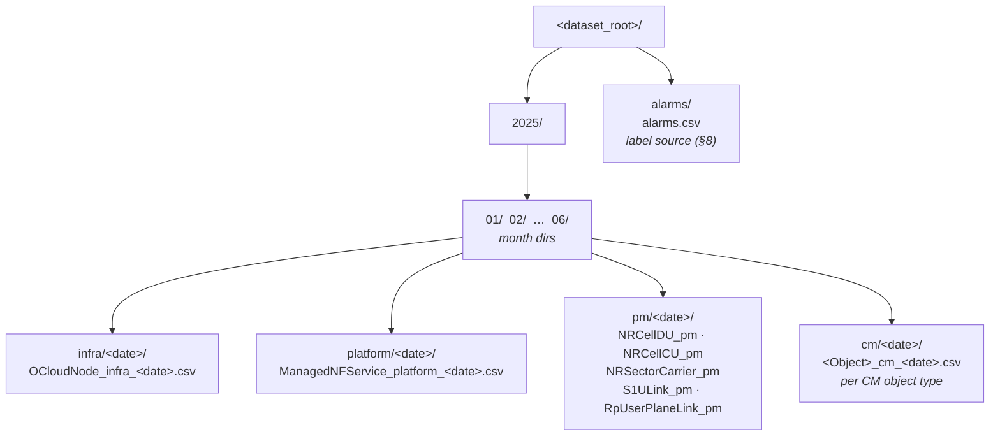
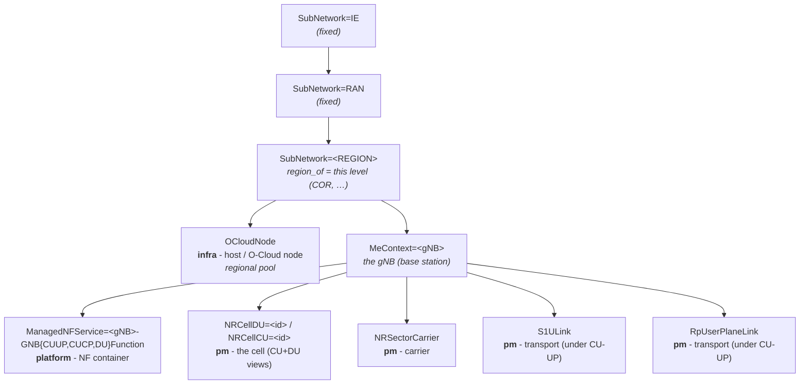
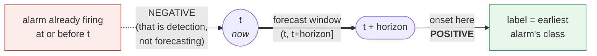

# Dataset Reference - autofm Multi-Level 5G NR (O-RAN) Telemetry & Alarms

Full technical reference for the autofm dataset: schema, topology, the normative
labeling and loader/ML contract, data-quality register, and lineage.

> **Start with the overview.** For the short, visual introduction - what the
> dataset is and why it matters - read
> [`DATASET_SPEC.md`](DATASET_SPEC.md) first. This reference is the deep detail
> behind it, for implementers.

> **Scope.** This document specifies the dataset **as implemented in the
> repository today**: a *real* multi-level O-RAN telemetry export, labeled from a
> separate alarm feed. It is the single source of truth for the dataset's
> schema, topology, labeling contract, and the loader/ML contract built on it.
> It does **not** describe a synthetic data generator; the previous
> generator-oriented revision has been withdrawn.

---

## Table of contents

1. [Overview](#1-overview)
2. [Corpus at a glance](#2-corpus-at-a-glance)
3. [On-disk layout](#3-on-disk-layout)
4. [Common record format](#4-common-record-format)
5. [Topology & identity (the `fdn`)](#5-topology--identity-the-fdn)
6. [Telemetry levels & data dictionary](#6-telemetry-levels--data-dictionary)
7. [Configuration management (CM)](#7-configuration-management-cm)
8. [Alarm feed & the labeling contract](#8-alarm-feed--the-labeling-contract)
9. [Loader requirements (normative)](#9-loader-requirements-normative)
10. [Feature & ML pipeline contract](#10-feature--ml-pipeline-contract)
11. [Data-quality & known-issues register](#11-data-quality--known-issues-register)
12. [Lineage, versioning & reproducibility](#12-lineage-versioning--reproducibility)
13. [Appendix: reading conventions](#appendix-reading-conventions)

---

## 1. Overview

autofm forecasts faults in a virtualized 5G NR O-RAN deployment before they
cause outages. A single fault surfaces across three operational levels at once - infrastructure (host), platform (network-function container), and RAN (cells,
carriers, transport). Monitoring one level in isolation invites misdiagnosis;
the dataset deliberately spans all three so the model can attribute a RAN symptom
to its true origin.

The dataset has two parts:

1. **Multi-level telemetry** - four levels of time-series counter data
   (`infra`, `platform`, `pm`, `cm`), exported as per-day, `;`-delimited CSVs
   over an `fdn`-addressed managed-object topology.
2. **An alarm feed** (`alarms/alarms.csv`) - the **label source**. Telemetry
   carries *no* inline fault label. Each alarm is a time interval on an `fdn`;
   the labeler ([§8](#8-alarm-feed--the-labeling-contract)) converts the feed into
   a supervised **fault-forecasting** target on the telemetry.

This separation makes the FM task genuine forecasting - *predict the precursor
in the telemetry before the alarm fires* - rather than detecting an alarm that
is already present. The leakage-safe labeling rule ([§8.3](#83-forecast-labeling-rule-normative))
is the mechanism that guarantees it.

---

## 2. Corpus at a glance

The reference corpus profiled for this specification. **[PROFILE]** - from
`docs/DATA_NOTES.md`, generated by `autofm/profile_dataset.py`.

| Property | Value |
|----------|-------|
| Date range | 2025-01-01 → 2025-07-01 (**182 days**) |
| Telemetry levels | `infra`, `platform`, `pm`, `cm` - 182 day-directories each |
| ROP cadence | 15-minute Recording Output Period; **96 ROPs/day** |
| RAN cells | **300** (each present as NRCellCU + NRCellDU + NRSectorCarrier) |
| Hosts (O-Cloud nodes) | 64 |
| NF service containers | 300 |
| Transport links | 1,200 `RpUserPlaneLink` + 9,000 `S1ULink` |
| Alarms (labels) | **2,867**, spanning 2025-01-01 → 2025-07-01 |
| Probable-cause vocabulary | 24 distinct values → 9-class taxonomy ([§8.2](#82-probable-cause-taxonomy)) |

---

## 3. On-disk layout

The corpus is foldered by **year / month / level / day**. **[CODE]**
`autofm/data/loader.py` (`_day_dirs`, `load`) walks exactly this structure.



- A conforming loader **MUST** discover day-directories by globbing
  `2025/*/<level>/*` and sort them by date. **[CODE]** `_day_dirs`.
- Per-group files **MUST** be matched by the pattern `<Group>_<level>_*.csv`
  within a day-directory. **[CODE]** `_read_group`.
- `dataset_root` is machine-specific and **MUST NOT** be committed; it is set per
  machine via config (`config_autofm.yaml`, `config_leonardo.yaml`). **[CONFIG]**
  `dataset_root`.

---

## 4. Common record format

Every telemetry CSV - at all four levels - shares one record convention, so a
single loader reads them all. **[CODE]** `autofm/fdn.py::META_COLS`.

- **Delimiter:** `;` between fields.
- **Metadata columns (fixed, leading block):**
  `fdn, mecontext, cell, rdiTimestamp, rdiTimestampTZ, ropCount`.
- **Feature columns:** everything after the metadata block; all numeric,
  coerced with `pd.to_numeric(..., errors="coerce")` so non-numeric cells become
  `NaN` rather than failing the read. **[CODE]** `_read_group`.
- **Timestamp:** `rdiTimestampTZ` is the authoritative timezone-aware 15-minute
  ROP timestamp used for all time operations. **[CODE]** `loader.TS`.

| Column | Meaning | Populated at |
|--------|---------|--------------|
| `fdn` | Full Distinguished Name - managed-object identity ([§5](#5-topology--identity-the-fdn)) | all levels |
| `mecontext` | Managed-element context | RAN levels |
| `cell` | Cell id (RAN cell objects only) | NRCellDU / NRCellCU |
| `rdiTimestamp` | ROP timestamp (naive) | all levels |
| `rdiTimestampTZ` | ROP timestamp (tz-aware) - **the time key** | all levels |
| `ropCount` | ROPs aggregated into the row | all levels |

> **Entity identity lives in the `fdn`.** The `cell` column is populated only
> for NRCellDU/NRCellCU; for every other group (carrier, transport, host,
> container) the entity **MUST** be parsed from the `fdn` ([§5](#5-topology--identity-the-fdn)).

---

## 5. Topology & identity (the `fdn`)

Every managed object is identified by an `fdn`: a comma-separated chain of
`key=value` components, outermost first. **[CODE]** `autofm/fdn.py`.

```
SubNetwork=IE,SubNetwork=RAN,SubNetwork=COR,MeContext=CORDU08,...,NRCellDU=CIDU1U
```

Parsing is centralized in `autofm/fdn.py` so the loader, labeler, and profiler
agree exactly. A conforming consumer **MUST** use this parse (not ad-hoc string
splitting):

| Function | Returns |
|----------|---------|
| `parse_fdn(fdn)` | `{key: value}` dict, **last wins** (collapses repeated `SubNetwork`) |
| `fdn_kv_pairs(fdn)` | ordered `(key, value)` list - **keeps** repeated keys |
| `region_of(fdn)` | the **3rd** `SubNetwork` level (the region), else `None` |
| `object_type(fdn)` | the last (most specific) key - the entity type |

### 5.1 The host → container → RAN hierarchy



### 5.2 Join keys (normative)

The **cell is the primary training entity**: it carries the richest counters
(NRCellDU + NRCellCU) and the bulk of labels. Each cell is enriched with its
gNB's platform and its region's infra context. **[CODE]** `loader.load`.

| Link | Join key | Rule | Source |
|------|----------|------|--------|
| NRCellDU ↔ NRCellCU | `(gnb, cell, rdiTimestampTZ)` | same gNB + cell id | `_gnb_of_cell`, `_cell_of_cell` |
| cell ↔ platform (NF) | `(gnb, rdiTimestampTZ)` | NF service name prefix before `-` = gNB; NF rows **mean-aggregated** per gNB | `_gnb_of_container` |
| cell ↔ infra (host) | `(region, rdiTimestampTZ)` | hosts are a **regional O-Cloud pool**, not per-gNB; host rows **mean-aggregated** per region | `region_of` |

> **Why infra joins on region, not host.** Host names (e.g. `CORDU01`) do **not**
> map 1:1 to a cell's `ManagedElement`. Hosts serve a region as a pool, so the
> reliable, lossless join is `region → cell`. This is a deliberate, documented
> modelling decision, not an approximation artifact. **[CODE]** `loader.load`,
> `fdn.region_of`.

All node identifiers in examples are **illustrative placeholders**, not real
network identifiers.

---

## 6. Telemetry levels & data dictionary

Per-level group inventory. Row/column/entity counts are **[PROFILE]** (the
2025-H1 corpus); the group→level→entity-type mapping is **[CODE]**
(`loader.py`, `labels.py`).

| Level | Group | Entity type | Entities | Rows/day | Cols | Numeric features | ROPs/day |
|-------|-------|-------------|---------:|---------:|-----:|-----------------:|---------:|
| `infra` | **OCloudNode** | host | 64 | 6,144 | 19 | **13** | 96 |
| `platform` | **ManagedNFService** | NF container | 300 | 28,800 | 16 | **10** | 96 |
| `pm` | **NRCellCU** | cell (CU view) | 300 | 28,800 | 282 | **242** | 96 |
| `pm` | **NRCellDU** | cell (DU view) | 300 | 28,800 | 280 | **152** | 96 |
| `pm` | **NRSectorCarrier** | carrier | 300 | 28,800 | 28 | **6** | 96 |
| `pm` | **RpUserPlaneLink** | transport link | 1,200 | 115,200 | 32 | **0** | 96 |
| `pm` | **S1ULink** | transport link | 9,000 | 864,000 | 11 | **0** | 96 |

Notes on the numbers (all **[PROFILE]**):

- **"Numeric features"** is the count of columns that survive numeric coercion in
  this corpus; non-numeric or all-null columns are not counted and are dropped
  downstream ([§10.1](#101-feature-cleaning)).
- **NRCellDU / NRCellCU** are the two views of one cell and are joined into a
  single per-cell feature row ([§5.2](#52-join-keys-normative)); together they
  supply the bulk of the **~394 raw per-cell counters** (152 + 242) before
  enrichment.
- **RpUserPlaneLink and S1ULink report 0 numeric feature columns in this
  corpus.** They are per-link transport objects (1,200 and 9,000 distinct links)
  whose numeric payload did not survive coercion in the profiled export; the
  as-built loader therefore **does not** fold raw transport counters into the
  cell feature vector. Transport still contributes to **labels** via alarm scope
  ([§8.1](#81-alarm-scope-resolution)). Any future use of transport *features*
  **MUST** first re-profile these groups and define an aggregation rule
  (link → owning gNB → cell), as transport is per-link, not per-cell.

### 6.1 Feature naming after load

The loader prefixes every feature column by its level so provenance is explicit
in the tensor. **[CODE]** `loader.load` (`feature_cols` filter):

| Prefix | Origin |
|--------|--------|
| `du_*` | NRCellDU counter |
| `cu_*` | NRCellCU counter |
| `plat_*` | platform (NF container) metric, gNB-aggregated |
| `infra_*` | infra (host) metric, region-aggregated |

The model input is exactly the set of `du_* / cu_* / plat_* / infra_*` columns.

---

## 7. Configuration management (CM)

The `cm` level holds per-day configuration-attribute tables, one CSV per managed
object type, in the same `;`-delimited convention. CM is **not** consumed by the
as-built training pipeline today; it is documented here because it is part of the
corpus and is a designed-for input (`SYSTEM_DESIGN.md` §7, CM pillar).

**[PROFILE]** 34 CM object types present. Largest by attribute count:
`NRCellDU` (2,360 attrs), `NRCellCU` (2,358), `SectorEquipmentFunction` (818),
`NRFrequency` (83), `NRSectorCarrier` (115). The remainder are small per-cell
profile tables (`DrxProfile`, `Rach`, `AdmissionLimit`, `McpcPCellProfile`, …),
each 11–33 attributes. See `docs/DATA_NOTES.md` for the full list.

---

## 8. Alarm feed & the labeling contract

Labels are **not** inline in the telemetry. They are derived from
`alarms/alarms.csv` by `autofm/data/labels.py`. This section is the normative
labeling contract.

### 8.1 Alarm record & scope resolution

**[PROFILE]** `alarms.csv` is `;`-delimited with columns:
`eventTime, fdn, eventType, probableCause, specificProblem, perceivedSeverity,
recordType, clearTime`. The reference corpus has **2,867** alarms; severities
`{MAJOR: 1700, CRITICAL: 558, MINOR: 405, WARNING: 204}`; durations
min/median/max = 30 / 180 / 495 minutes.

Each alarm is an interval `[eventTime, clearTime]` on an `fdn`. An alarm with no
`clearTime` is treated as open until `eventTime + 1 day`. **[CODE]**
`load_alarms`.

**Scope resolution** maps the alarm's `fdn` to the telemetry entities it affects.
**[CODE]** `labels._resolve_scope`:

| Alarm object (`object_type`) | Scope | Affected telemetry |
|------------------------------|-------|--------------------|
| `NRCellDU` | **cell** | that exact cell `(gnb, cell)` |
| `S1ULink` | **gnb** | all cells of the alarm's gNB (`MeContext`) |
| `ManagedNFService` | **gnb** | all cells of the alarm's gNB (service-name prefix) |
| `OCloudNode` | **region** | all cells in the alarm's region (`SubNetwork`) |
| *(any other)* | **region** | widest scope - all cells in the region |

**[PROFILE]** alarm attachment by object type in the reference corpus:
`OCloudNode: 862`, `NRCellDU: 853`, `ManagedNFService: 759`, `S1ULink: 393`.
These four cover the host → container → RAN chain - infra and transport faults
are attached to their downstream cells so they are learnable from the
cell-indexed tensor, while the true origin `fdn` is preserved for localization.

### 8.2 Probable-cause taxonomy

The 24 raw `probableCause` values are grouped into a compact **9-class**
taxonomy. Class `0` is reserved for **Normal** (no imminent alarm). **[CODE]**
`labels.CAUSE_TO_CLASS`, `labels.CLASS_NAMES`.

| id | Class | Raw `probableCause` values folded in |
|---:|-------|--------------------------------------|
| 0 | **Normal** | *(no in-horizon alarm onset)* |
| 1 | **Resource** | congestion, outOfMemory, storageCapacityProblem |
| 2 | **Hardware** | highTemperature, coolingSystemFailure, powerProblem, equipmentMalfunction, replaceableUnitProblem |
| 3 | **Radio** | degradedSignal, lossOfSignal, lossOfFrame, lossOfSynchronisation |
| 4 | **Performance** | performanceDegraded, thresholdCrossed |
| 5 | **Transport** | lanError, connectionEstablishmentError |
| 6 | **Software** | softwareError, configurationError, proceduralError |
| 7 | **Security** | informationModificationDetected, authenticationFailure, keyExpired, cableTamper |
| 8 | **Other** | indeterminate |

Any `probableCause` not in the map **MUST** fall back to **Other**. **[CODE]**
`CAUSE_TO_CLASS.get(cause, "Other")`.

### 8.3 Forecast labeling rule (normative)

Two labels are emitted per telemetry row `(gnb, cell, t)`. **[CODE]**
`labels.label_frame`:

| Label | Type | Definition |
|-------|------|------------|
| `will_fault` | `int8` {0,1} | 1 iff an in-scope alarm **onsets** within the forecast horizon |
| `fault_class` | `int64` [0..8] | class ([§8.2](#82-probable-cause-taxonomy)) of the **earliest-onsetting** qualifying alarm; `0` when none |

A row is **positive** iff an in-scope alarm's `eventTime` satisfies:

```
t < eventTime ≤ t + horizon·ROP          (ROP = 15 min)
```



An alarm that starts **inside** the future window makes the row positive; one
already firing at `t` does not. That asymmetry is the whole game - it forces the
model to read the *precursor* in the telemetry, not the alarm itself.

- The interval is **left-open**: an alarm already firing at or before `t`
  **MUST NOT** make the row positive. Detecting a present alarm is not
  forecasting; including it would be **label leakage**. **[CODE]**
  `overlap = mask & (start > t) & (start <= win_end)`.
- When multiple alarms qualify, the **earliest-onsetting** one's class wins (the
  imminent fault). **[CODE]** `closer = overlap & (start < best_start)`.
- `horizon` is the forecast lead time in ROPs. **[CONFIG]** `horizon` (default
  **5** ROPs = 75 min ahead).

### 8.4 Label diagnostics

The labeler counts and reports alarms that (a) match no in-scope telemetry row,
or (b) match rows but never overlap a forecast window, so scope/topology
mismatches surface instead of being silently dropped. A conforming labeler
**SHOULD** emit these counts. **[CODE]** `labels.label_frame`
(`n_no_scope_match`, `n_no_window_overlap`).

---

## 9. Loader requirements (normative)

A conforming loader (`autofm/data/loader.py`) **MUST**:

1. Discover day-directories via `2025/*/<level>/*` and process them in date
   order. **[CODE]** `_day_dirs`.
2. Read `;`-delimited CSVs as strings, then numeric-coerce feature columns with
   `errors="coerce"` (tolerating non-numeric/ragged cells). **[CODE]**
   `_read_group`.
3. Parse entity identity from the `fdn` via `autofm/fdn.py` when the `cell`
   column is blank. **[CODE]** `_gnb_of_cell`, `_cell_of_cell`,
   `_gnb_of_container`, `region_of`.
4. Join NRCellDU + NRCellCU into one per-cell row on `(gnb, cell,
   rdiTimestampTZ)`; attach platform on `(gnb, ts)` and infra on `(region, ts)`
   with the documented mean-aggregation. **[CODE]** `load`.
5. Drop rows with a null time key, gNB, or cell, and sort by
   `(gnb, cell, rdiTimestampTZ)`. **[CODE]** `load`.
6. Expose scale knobs that bound cost for local runs: `max_days`, `max_gnbs`
   (both `None` = full corpus). **[CONFIG]** `max_days`, `max_gnbs`.

The loader **SHOULD** be defensive about export irregularities ([§11](#11-data-quality--known-issues-register)).

---

## 10. Feature & ML pipeline contract

How the dataset is turned into model-ready tensors and consumed, end to end.
**[CODE]** `autofm/data/features.py`, `autofm/pipeline.py`,
`autofm/metrics.py`. These rules keep reported metrics trustworthy (no leakage)
and reproducible.

### 10.1 Feature cleaning

**[CODE]** `features._clean_features`:

- Columns that are **entirely null** across the loaded data are dropped.
- Remaining sparse counters are **forward- then backward-filled per cell**
  (dense 15-min telemetry), then any residual `NaN` is zero-filled.
- Fills are grouped by `cell` so values never bleed across entity boundaries.

### 10.2 Chronological split (leakage-safe)

- **60 % train / 20 % val / 20 % test, split on ROP time**; val and test are
  strictly **after** train. No shuffling across the time boundary. **[CODE]**
  `features.prepare` (`train_frac=0.6`, `val_frac=0.2`), `_time_split_bounds`.
- Split boundary indices are clamped to `[0, n-1]` so a smoke-scale run with few
  distinct ROPs cannot underflow and silently wrap. **[CODE]**
  `_time_split_bounds`.

### 10.3 Normalization (fit on train only)

- Per-feature mean/std are computed on the **train split only** and applied
  unchanged to val and test. **[CODE]** `_standardize_fit`, `prepare`.
- Constant columns (`std == 0`) are guarded to `std = 1`. **[CODE]**
  `_standardize_fit`.

### 10.4 Windowing

- Per-cell sliding lookback windows of length `k`, stride 1, producing tensors
  of shape `(N, k, F)`. **[CODE]** `_make_windows`.
- Windows **MUST NOT** cross a cell boundary - a window is always one cell's
  contiguous history. **[CODE]** `_make_windows` (`groupby("cell")`).
- The window's label is its **final step's** `will_fault` / `fault_class`
  (causal, no look-ahead; the horizon is already baked in at label time).
  **[CODE]** `yb.append(wf[end-1])`.
- Window length `k`. **[CONFIG]** `window_k` (default **32** in the configs;
  the `features.prepare` API default is 60). The config value governs pipeline
  runs. **[CODE]** `pipeline.run` passes `k=cfg["window_k"]`.

### 10.5 Compression & model

The pipeline compresses each windowed ROP vector to a latent, then runs a
temporal classifier. **[CODE]** `pipeline.run`, `SYSTEM_DESIGN.md` §6:

- **Compressor:** `pca` (fast baseline) or `mae` (autofm design), to **latent
  dim 32**. **[CONFIG]** `compressor`, `latent_dim`.
- **Backbone:** `transformer` or `patchtst` (`patch_size=5`). **[CONFIG]**
  `clf_backbone`, `patch_size`.
- **Head:** `softmax` (baseline) or `evidential` (adds uncertainty). **[CONFIG]**
  `clf_head`.

The MAE compresses to a **32-dim latent** and the window is **32 ROPs** with
`patch_size=5` - consistent with `SYSTEM_DESIGN.md` §6 (latent dim 32).

### 10.6 Evaluation metrics

Fault forecasting is heavily imbalanced (most windows are Normal), so **plain
accuracy is not reported as the headline**. **[CODE]** `autofm/metrics.py`:

| Family | Metrics |
|--------|---------|
| **Multi-class** (fault type) | **macro-F1 (headline)**, weighted-F1, balanced accuracy, per-class precision/recall/F1/support, confusion matrix |
| **Binary fault** (Normal vs any fault) | precision, recall (faults caught), F1, **PR-AUC (headline under imbalance)**, ROC-AUC, Brier |

- **macro-F1** is the fault-type headline: a Normal-always predictor scores high
  accuracy but near-zero macro-F1, so macro-F1 prevents a majority-class model
  from looking strong. **[CODE]** `multiclass_metrics`; `SYSTEM_DESIGN.md` §10.
- **PR-AUC** is the binary headline: "when we raise a fault alert, how
  trustworthy is it, and how many real faults do we catch." Threshold-free
  ranking metrics are computed only when both classes are present. **[CODE]**
  `binary_fault_metrics`.

### 10.7 Scale knobs

| Knob | Smoke (`config_autofm.yaml`) | Full (`config_leonardo.yaml`) |
|------|------------------------------|-------------------------------|
| `max_days` | 14 | 182 |
| `max_gnbs` | 40 | 100 |
| `mae_epochs` / `clf_epochs` | 6 / 12 | 50 / 50 |
| `compressor` / `backbone` / `head` | mae / transformer / softmax | mae / patchtst / evidential |
| `batch_size` | *(default)* | 1024 |

**[CONFIG]** both config files.

---

## 11. Data-quality & known-issues register

Characteristics and hazards of the **source export** that any consumer must
tolerate. **[PROFILE]** / **[CODE]** as tagged.

| # | Issue | Handling | Source |
|---|-------|----------|--------|
| DQ-1 | Non-numeric / all-null feature columns in the raw CSVs | numeric-coerce with `errors="coerce"`, then drop all-null columns | **[CODE]** `_read_group`, `_clean_features` |
| DQ-2 | `RpUserPlaneLink` / `S1ULink` expose **0 numeric feature columns** in the profiled corpus | excluded from cell features; used for labels only ([§6](#6-telemetry-levels--data-dictionary)) | **[PROFILE]** |
| DQ-3 | Host names are a regional pool, not per-gNB | infra joined on **region**, not host | **[CODE]** `region_of`, `load` |
| DQ-4 | Alarms with missing `clearTime` | treated as open until `eventTime + 1 day` | **[CODE]** `load_alarms` |
| DQ-5 | Alarms whose scope matches no telemetry row / no forecast window | counted and reported, then dropped | **[CODE]** `label_frame` |
| DQ-6 | Sparse per-cell counters (gaps between ROPs) | per-cell ffill → bfill → zero-fill | **[CODE]** `_clean_features` |
| DQ-7 | Smoke-scale runs with very few distinct ROPs | split indices clamped to `[0, n-1]` | **[CODE]** `_time_split_bounds` |
| DQ-8 | `probableCause` outside the known vocabulary | mapped to **Other** (class 8) | **[CODE]** `CAUSE_TO_CLASS.get(..., "Other")` |

> **Sibling-cell label correlation (analysis caveat).** Infra, transport, and NF
> alarms attach to **all** cells of a gNB/region ([§8.1](#81-alarm-scope-resolution)).
> Those sibling cells therefore receive correlated positive labels, so the number
> of *independent* positive examples for non-cell-origin classes is closer to the
> count of affected gNBs/regions than to the count of cell-windows. Per-class
> example counts **SHOULD** be read with this correlation in mind.

---

## 12. Lineage, versioning & reproducibility

- **Provenance.** This is a *real* O-RAN telemetry + alarm export. The RAN
  (`pm`, `cm`) trees follow a conventional 5G NR PM/CM export schema (group
  names, `pm*` counters, `fdn` topology, ROP cadence); `infra`/`platform` are
  O-Cloud host/container telemetry. Counter and object **names are
  implementation-specific identifiers**, aligned to 3GPP NR measurement families
  (TS 28.552) and the 5G NRM (TS 28.541) in concept, **not** literal standard
  strings.
- **Topology caveats.** `S1ULink` reflects an **NSA / EN-DC** deployment (LTE/EPC
  S1-U user plane); `RpUserPlaneLink` is an **implementation-specific** transport
  managed object, not a 3GPP NRM class. Both are user-plane bearers under the
  CU-UP.
- **Determinism.** The pipeline is seeded from a single master seed. **[CONFIG]**
  `seed` (default 42). The **data build and labeling** are deterministic given a
  fixed export and config. **Training** is seed-stable but **not** guaranteed
  bitwise-identical across GPU/hardware (CUDA/cuDNN atomics, DDP reduction
  ordering).
- **Profiling.** All **[PROFILE]** figures are regenerable with
  `python -m autofm.profile_dataset`, which writes `docs/DATA_NOTES.md`. Re-run
  it whenever the export changes; this spec's **[PROFILE]** numbers then
  **MUST** be reconciled against the new `DATA_NOTES.md`.
- **Document versioning.** This spec uses semantic versioning. Breaking changes
  to the schema, labeling rule, or ML contract bump the **major** version.

---

## Appendix: reading conventions

The key words **MUST**, **MUST NOT**, **SHOULD**, **SHOULD NOT**, and **MAY** in
this document are to be interpreted as described in RFC 2119: they denote
**normative** requirements on any conforming loader, labeler, or training
pipeline.

Every quantitative claim is tagged with its **source of truth**:

| Tag | Meaning |
|-----|---------|
| **[CODE]** | Enforced by repository source; cites the module. |
| **[PROFILE]** | Measured by `python -m autofm.profile_dataset`; recorded in `docs/DATA_NOTES.md`. |
| **[CONFIG]** | A configurable default; cites the config key. |

Figures tagged **[PROFILE]** describe **one specific export** (the 182-day
2025-H1 corpus profiled in `docs/DATA_NOTES.md`) and will differ for other
exports; the **schema and contract** (everything **[CODE]**) are invariant.

---

## Disclaimer

autofm is an independent project developed for the European AI Hackathon 2026.
It is **not** an official Ericsson product and is **not** endorsed by or
affiliated with Ericsson. All node, cell, and network identifiers in this
document are illustrative placeholders.

---

*Team AFM_Ericsson - European AI Hackathon 2026*
