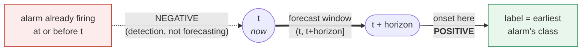
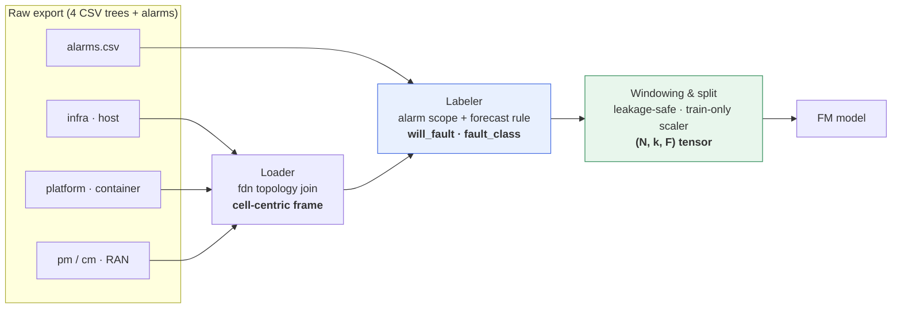

# Dataset Overview - autofm Multi-Level 5G NR (O-RAN) Telemetry & Alarms

The dataset the Fault Management phase of **autofm** learns from, in one read.

> Short overview. For the full schema, data dictionary, and the normative
> loader/ML contract, see [`DATASET_REFERENCE.md`](DATASET_REFERENCE.md).

---

## The problem

In a virtualized O-RAN deployment a single fault surfaces at **three levels at
once**: a host CPU spike (infrastructure) throttles a container (platform) and
shows up as packet loss in the RAN. Watch one level and you misdiagnose - the
RAN symptom looks like a radio fault when the real cause is the host.

**This dataset spans all three levels**, so the model can trace a symptom back
to its true origin instead of blaming the nearest one.

## The clever part

The telemetry carries **no fault label**. Labels come from a *separate* alarm
feed, under one strict rule: a moment counts as a fault only if an alarm
**starts in the future window** `(t, t+horizon]` - never if it is already
firing. That turns the task from *detecting an alarm already present* into
*forecasting the precursor before it fires*, which is what makes the results
meaningful rather than a lookup.

## What you get

| | |
|---|---|
| **What it is** | Real multi-level 5G NR O-RAN telemetry (infra · platform · RAN) + an alarm feed |
| **Scale** | 182 days · 300 cells · 15-min cadence (96 ROPs/day) · 2,867 alarms |
| **The task** | Forecast *which* fault class will hit *which* cell, *how soon* - from telemetry alone |
| **Why it is hard** | Faults cross levels; labels live in a separate feed; most windows are Normal (heavy imbalance) |
| **The output** | A cell-indexed, leakage-safe, model-ready tensor with an honest forecasting target |

## How it is built

1. **Load** the four telemetry levels and join them into one **cell-centric**
   frame using the `fdn` topology (each cell enriched with its gNB's container
   and its region's host metrics).
2. **Label** each `(cell, time)` row from the alarm feed using the forecast rule
   above - `will_fault` (0/1) and a `fault_class` (one of 9 classes: Normal +
   8 cause groups).
3. **Window and split** into fixed-length per-cell lookback windows with a
   chronological 60/20/20 split and train-only normalization, so there is no
   leakage.

## The three levels

| Level | Entity | Carries |
|-------|--------|---------|
| **Infrastructure** | host (O-Cloud node) | CPU, memory, temperature, power |
| **Platform** | NF container (CU / DU) | container CPU, memory, restarts |
| **RAN** | cell, carrier, transport link | 5G NR PM counters + CM config |

The **cell is the primary training entity** - it carries the richest counters
and most of the labels; infrastructure and platform metrics are attached to it
through the topology.

## Want the detail?

[`DATASET_REFERENCE.md`](DATASET_REFERENCE.md) has it all: on-disk layout, the
record format, the full `fdn` topology and join keys, the per-group data
dictionary, the 9-class taxonomy, the complete labeling and loader/ML contract,
the data-quality register, and lineage.

---

## Disclaimer

autofm is an independent project developed for the European AI Hackathon 2026.
It is **not** an official Ericsson product and is **not** endorsed by or
affiliated with Ericsson. All node, cell, and network identifiers are
illustrative placeholders.

---

*Team AFM_Ericsson - European AI Hackathon 2026*
