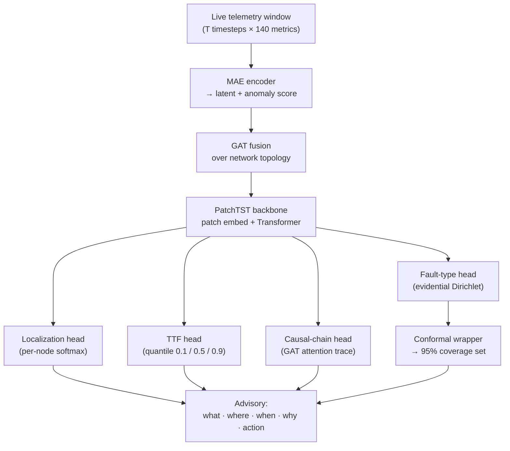
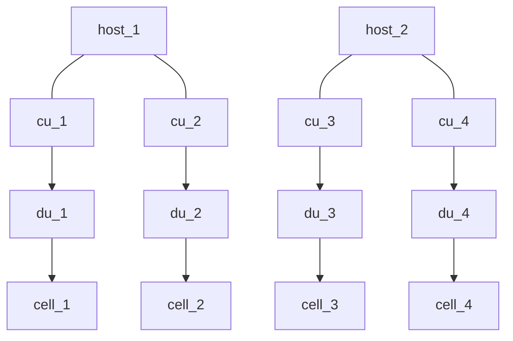
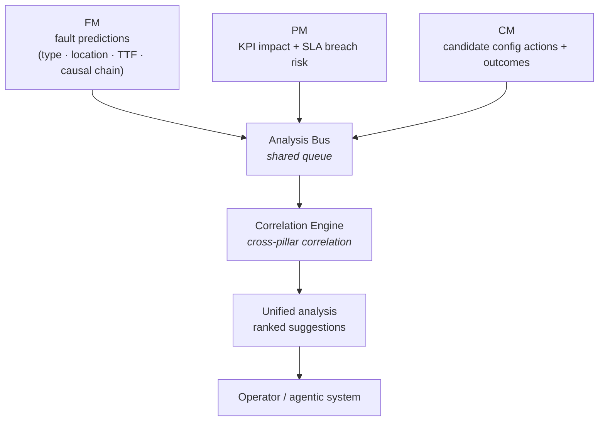
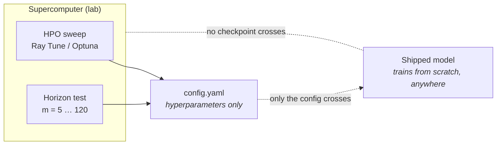
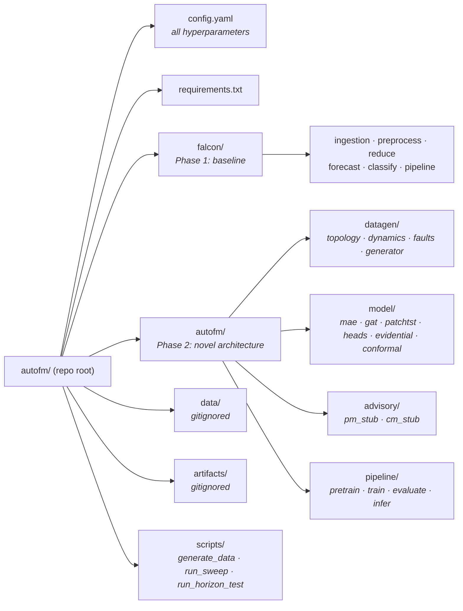

# autofm - System Design

**Autonomous Fault Management for Open RAN in the ML/Agentic Era**

Team AFM_Ericsson · European AI Hackathon 2026

---

## Table of contents

1. [Problem](#1-problem)
2. [Vision](#2-vision)
3. [Traditional approach vs. autofm](#3-traditional-approach-vs-autofm)
4. [System overview](#4-system-overview)
5. [Inference flow](#5-inference-flow)
6. [Synthetic data](#6-synthetic-data)
7. [Model architecture](#7-model-architecture)
8. [FM / PM / CM and the Analysis Bus](#8-fm--pm--cm-and-the-analysis-bus)
9. [Supercomputer strategy](#9-supercomputer-strategy)
10. [Project structure](#10-project-structure)
11. [Tech stack](#11-tech-stack)
12. [Evaluation](#12-evaluation)
13. [Timeline (Oct 6-29)](#13-timeline-oct-6-29)

- [Terminology](#terminology)

---

## Terminology

| Term | Meaning |
|------|---------|
| **O-RAN** | Open Radio Access Network - a disaggregated, multi-vendor RAN architecture with open interfaces. |
| **RAN** | Radio Access Network - the radio-side application layer (cells, connected UEs, bitrate, signal quality). |
| **Infrastructure** | The host layer: physical/virtual servers (CPU, memory, temperature). |
| **Platform** | The network-function layer running on hosts (containers: CU, DU, RIC, core). |
| **Host** | A compute node in the infrastructure layer. |
| **CU** | Centralized Unit - the upper-layer RAN function. |
| **DU** | Distributed Unit - the lower-layer, time-critical RAN function. |
| **RIC** | RAN Intelligent Controller - control/optimization of RAN functions. |
| **Cell** | A radio coverage unit served by a DU. |
| **UE** | User Equipment - an end device (e.g., phone) connected to the RAN. |
| **FM** | Fault Management - predict, diagnose, and warn about faults (Phase 1). |
| **PM** | Performance Management - measure KPI impact and SLA risk. |
| **CM** | Configuration Management - suggest and rank config actions. |
| **KPI** | Key Performance Indicator - a measured network performance metric. |
| **SLA** | Service Level Agreement - a committed service quality threshold. |
| **TTF** | Time-To-Failure - predicted seconds until a fault label flips. |
| **Causal path / chain** | The ordered sequence of nodes along which a fault propagates. |
| **Degradation ramp** | The subtle warning-sign window (15-90s) before a fault label flips. |
| **Analysis Bus** | Shared central queue where FM/PM/CM publish outputs for cross-pillar correlation. |
| **Correlation Engine** | Consumer of the Analysis Bus that correlates signals across pillars. |
| **MAE** | Masked Autoencoder - self-supervised nonlinear representation learning. |
| **GAT** | Graph Attention Network - topology-aware fusion over the network graph. |
| **PatchTST** | Patch-based Transformer for time-series - the temporal attention backbone. |
| **PCA** | Principal Component Analysis - linear dimensionality reduction (baseline). |
| **LSTM** | Long Short-Term Memory - recurrent sequence model (baseline). |
| **RF** | Random Forest - ensemble tree classifier (baseline). |
| **Evidential DL** | Evidential Deep Learning - predicts a distribution (Dirichlet) giving classification plus uncertainty. |
| **Aleatoric uncertainty** | Uncertainty from inherent data noise (irreducible). |
| **Epistemic uncertainty** | Uncertainty from the model/limited data (reducible). |
| **Conformal Prediction** | Distribution-free, model-agnostic wrapper giving calibrated coverage sets. |
| **Coverage** | Fraction of cases the prediction set is guaranteed to contain the true label (e.g., 95%). |
| **OU process** | Ornstein-Uhlenbeck - a mean-reverting stochastic process used for metric dynamics. |
| **Horizon (m)** | Forecast lead time in timesteps (e.g., m=5 to 120). |
| **Checkpoint** | Saved trained model weights. |
| **HPO** | Hyperparameter Optimization - automated hyperparameter search (Ray Tune / Optuna). |
| **DDP** | Distributed Data Parallel - PyTorch multi-GPU/multi-node training. |
| **falcon** | Phase 1 baseline pipeline (traditional PCA + LSTM + RF approach). |

---

## 1. Problem

O-RAN's disaggregated architecture means faults can start at the
**infrastructure** (host), propagate through the **platform** (containers), and
surface at the **RAN** (radio) - causing cross-level misdiagnosis. Traditional
fault management is reactive and siloed.

**autofm predicts faults before they occur, and tells you where, when, why, and
what to do about it.**

---

## 2. Vision

A network-management framework for the ML/agentic era. FM is Phase 1; the same
core extends to PM and CM.

| Pillar | Role | Phase |
|--------|------|-------|
| **FM** | Predict + diagnose + warn | Built now |
| **PM** | Measure KPI impact + SLA risk | Designed for |
| **CM** | Suggest + rank config actions | Designed for |

---

## 3. Traditional approach vs. autofm

| Stage | Traditional (PCA + LSTM + RF) | autofm | Improvement |
|-------|-------------------------------|--------|-------------|
| **Representation** | PCA (linear) | Masked Autoencoder (nonlinear, self-supervised) | Captures cross-level coupling |
| **Temporal model** | LSTM (sequential) | PatchTST (parallel, interpretable) | GPU-friendly, attention-based |
| **Topology** | None (flat vector) | Graph Attention Network | Enables localization + causality |
| **Classification** | Random Forest (separate model) | Evidential Deep Learning (joint) | Uncertainty + end-to-end training |
| **Calibration** | None | Conformal Prediction | Guaranteed coverage |
| **Output** | Fault type only | Type + location + TTF + cause + action | Complete advisory |

---

## 4. System overview

> **Diagram 1**

```mermaid
flowchart LR
    subgraph TELE["Multi-level telemetry"]
        INF["Infrastructure<br/>(hosts)"]
        PLT["Platform<br/>(CU / DU / RIC)"]
        RAN["RAN<br/>(cells / UEs)"]
    end

    TELE --> DG["Synthetic data generator<br/><i>140 metrics · OU dynamics · coupling</i>"]
    DG --> MAE["MAE<br/><i>nonlinear representation</i>"]
    MAE --> GAT["GAT<br/><i>topology-aware fusion</i>"]
    GAT --> PTST["PatchTST<br/><i>temporal attention</i>"]
    PTST --> HEADS["Multi-task evidential heads<br/><i>type · location · TTF · cause</i>"]
    HEADS --> CP["Conformal Prediction<br/><i>calibrated coverage sets</i>"]
    CP --> ADV["Advisory output<br/>type · location · TTF · cause · action"]
```

---

## 5. Inference flow

> **Diagram 2**

---

## 6. Synthetic data

No live telemetry available. The generator is a **first-class component**.

**Topology:** 4 hosts, 4 CUs, 4 DUs, 4 cells (configurable). **140 metrics
total.**

> **Diagram 3**

**Dynamics:** Ornstein-Uhlenbeck process per metric (mean-reverting noise).
Cross-level coupling with propagation delays (host CPU up → DU CPU up → RAN
latency up).

**Fault types:** Normal, CPU Stress, Memory Stress, Packet Loss, **Cascading**
(novel - full cross-level propagation).

**Key design:** faults have a **degradation ramp** (15-90s of subtle warning
signs before the label flips). This makes "predict before it occurs" provable.

**Labels per timestep:** `fault_type`, `fault_origin_node`,
`time_to_failure_sec`, `causal_path`, `is_degrading`, `ramp_progress`.

---

## 7. Model architecture

### MAE - nonlinear representation learning

Self-supervised pretraining: mask 30-50% of metrics, reconstruct. 1D-Conv
encoder (D → 64 → 32 → latent). Learns nonlinear cross-level relationships.
Reconstruction error doubles as an anomaly score.

### GAT - topology-aware fusion

Multi-head graph attention (4 heads, 2 layers) over the network topology. Each
node's embedding is enriched by its neighbors. Attention weights reveal the
causal chain for free.

### PatchTST - temporal attention backbone

Patch embedding (`patch_size=5`), Transformer encoder (4 layers, 4 heads,
`embed_dim=128`). Parallelizable on GPU, interpretable via attention,
state-of-the-art for time-series.

### Multi-task evidential heads

Four parallel heads on the shared backbone:

| Head | Task | Method | Output |
|------|------|--------|--------|
| **Fault type** | Classification | Evidential DL (Dirichlet) | Class + aleatoric/epistemic uncertainty |
| **Localization** | Node classification | Per-node softmax | Origin-node ranking |
| **Time-to-failure** | Regression | Quantile (tau = 0.1, 0.5, 0.9) | Median + 80% interval |
| **Causal chain** | Structured | GAT attention trace | Ordered node path |

### Conformal Prediction (novel)

Post-hoc wrapper. Distribution-free, model-agnostic. Guaranteed coverage sets
(e.g., 95%).

---

## 8. FM / PM / CM and the Analysis Bus

FM, PM, and CM each produce structured outputs. Rather than forming a closed
loop between them, all three **publish their data to a shared Analysis Bus** - a
central queue where cross-pillar correlation and analysis happens. The outcome
of the Analysis Bus is a detailed, calculated analysis presented as suggestions
for operators or upstream systems to act on.

> **Diagram 4**

**How it works:**

- **FM** publishes fault predictions (type, location, TTF, causal chain) to the
  bus.
- **PM** publishes KPI impact assessments and SLA breach risk projections to the
  bus.
- **CM** publishes candidate config actions with estimated outcomes to the bus.
- The **Analysis Bus** aggregates all three streams. The **Correlation Engine**
  consumes from the bus and correlates across pillars - e.g., linking an FM
  fault prediction to a PM SLA breach to the CM actions that would resolve it.
- The output is a unified, calculated analysis with ranked suggestions delivered
  to the operator or an agentic system.

**Phase 1 (this hackathon):** FM is fully built. PM and CM are rule-based
advisory stubs. The Analysis Bus is demonstrated with a worked example showing
the cross-pillar correlation.

**Example:** FM predicts `CPU_Stress` on `du_2` (`host_1`), 35s out. PM projects
`cell_3` SLA breach in 90s. CM generates three candidate actions. The Analysis
Bus correlates all three and presents:

> "Migrate `du_2` to `host_3` - resolves the fault in ~8s, prevents the SLA
> breach, confidence 91%."

---

## 9. Supercomputer strategy

**Rule: no checkpoint crosses the boundary.** The lab discovers *what to build*
(a config). The shipped model trains from scratch, anywhere.

> **Diagram 5**

---

## 10. Project structure

---

## 11. Tech stack

**Core:** Python 3.14+, PyTorch >= 2.10, PyTorch Geometric, NumPy, Pandas,
scikit-learn, SciPy, XGBoost, MAPIE, matplotlib, networkx.

**Supercomputer only:** CUDA 12.x, Ray Tune / Optuna, TensorBoard, NVIDIA
Nsight, PyTorch DDP.

---

## 12. Evaluation

**Data split:** Chronological (60% train / 20% val / 20% test). No future
leakage.

**Tests:** Unit (pytest), integration (end-to-end shape checks), regression
(baseline holds), ablation (with/without each component), horizon degradation
(m = 5 to 120), robustness (sensor dropout, noise).

**Target metrics:**

| Metric | Traditional baseline | autofm target |
|--------|----------------------|---------------|
| Fault type accuracy (m=5) | ~98.7% | >= 99% |
| Fault type accuracy (m=30) | N/A | >= 90% |
| Localization accuracy | N/A | >= 85% |
| TTF RMSE | N/A | <= 10s |
| Inference latency | N/A | <= 50ms/step CPU |
| Conformal coverage | N/A | >= 95% |

---

## 13. Timeline (Oct 6-29)

| Date | Deliverable |
|------|-------------|
| Oct 6-7 | Repo setup, baseline running |
| Oct 8-10 | Synthetic data generator complete |
| Oct 11-13 | MAE + PatchTST + fault-type head. Mentor update. |
| Oct 14-16 | GAT + localization + TTF heads |
| Oct 17-19 | Evidential DL + conformal calibration |
| Oct 20-22 | Supercomputer: sweep + horizon test |
| Oct 23-25 | FM/PM/CM advisory loop |
| Oct 26-29 | Polish, ablation, demo, final submission |

---

Team AFM_Ericsson - European AI Hackathon 2026
