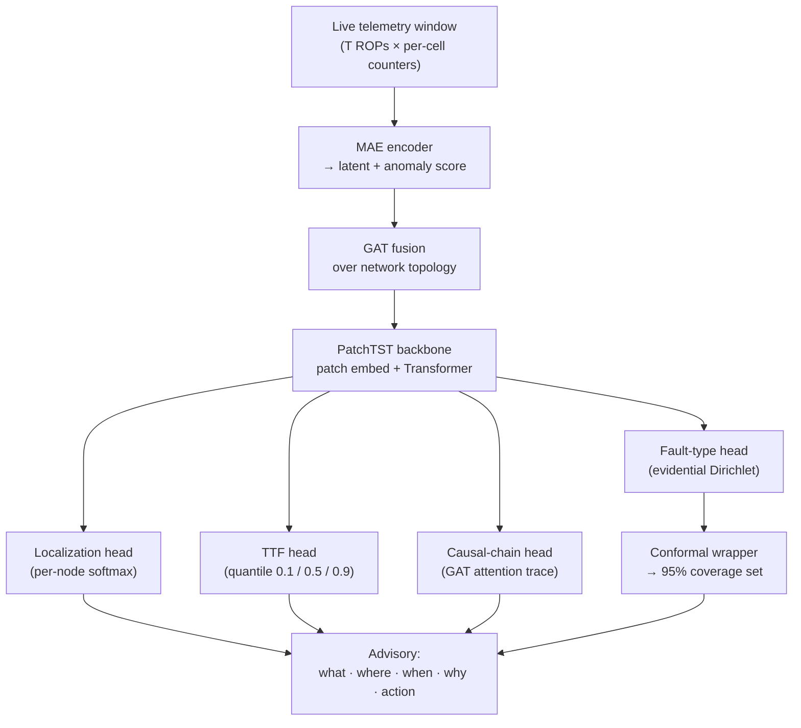
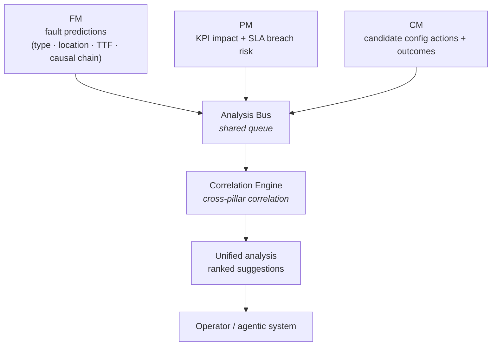
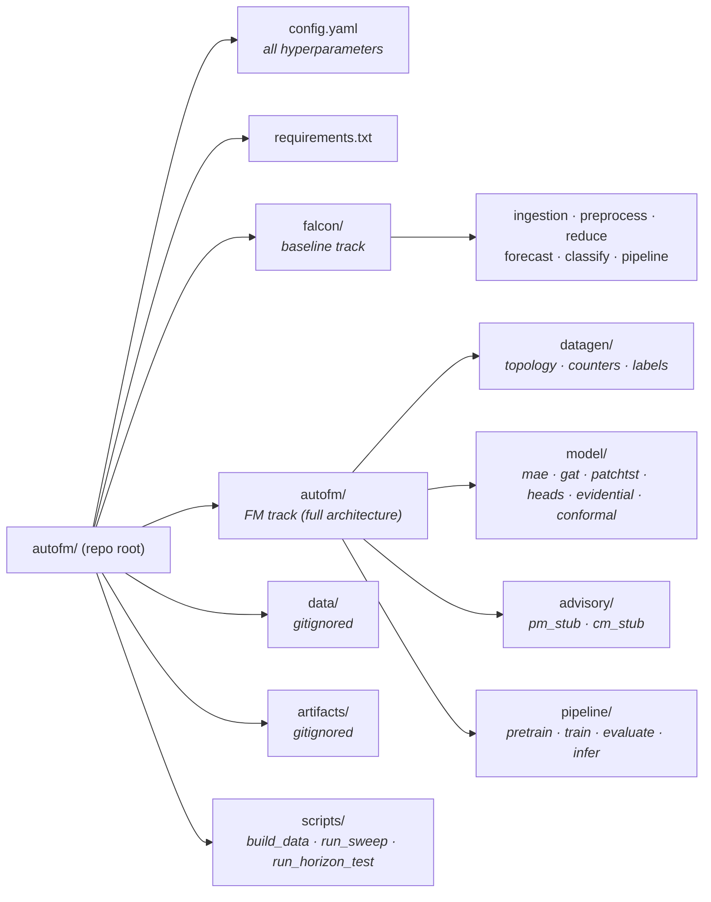

# autofm - Fault Management System Design

**Autonomous Fault Management for Open RAN**

Team AFM_Ericsson · European AI Hackathon 2026

---

## Table of contents

1. [Problem](#1-problem)
2. [Vision](#2-vision)
3. [The autofm approach](#3-the-autofm-approach)
4. [System overview](#4-system-overview)
5. [Inference flow](#5-inference-flow)
6. [Model architecture](#6-model-architecture)
7. [FM / PM / CM and the Analysis Bus](#7-fm--pm--cm-and-the-analysis-bus)
8. [Project structure](#8-project-structure)
9. [Tech stack](#9-tech-stack)
10. [Evaluation](#10-evaluation)
11. [Timeline (Oct 6-29)](#11-timeline-oct-6-29)

- [Terminology](#terminology)

---

## Terminology

| Term | Meaning |
|------|---------|
| **O-RAN** | Open Radio Access Network - a disaggregated, multi-vendor RAN architecture with open interfaces. |
| **RAN** | Radio Access Network - the radio-side layer (cells, carriers, connected UEs, bitrate, signal quality). |
| **gNB** | 5G NR base station (`ManagedElement`); hosts the CU, DU and transport functions. |
| **GNBDUFunction** | Distributed-unit function of a gNB; parents NRCellDU and NRSectorCarrier. |
| **GNBCUCPFunction** | Centralized-unit control-plane function; parents NRCellCU. |
| **GNBCUUPFunction** | Centralized-unit user-plane function; parents the user-plane transport links (S1-U in NSA/EN-DC; Rp is implementation-specific). |
| **NRCellDU / NRCellCU** | Distributed- and centralized-unit views of an NR cell. |
| **NRSectorCarrier** | Carrier served by a cell (power, downtime). |
| **Transport link** | User-plane bearers under the CU-UP: S1ULink (NSA/EN-DC S1-U) and RpUserPlaneLink (implementation-specific). |
| **Cell** | An NR cell; the CU/DU/SectorCarrier triple for one radio sector. |
| **UE** | User Equipment - an end device connected to the RAN. |
| **PM / CM** | Performance- and Configuration-Management counter/attribute data. |
| **ROP** | Recording Output Period - the 15-minute counter aggregation interval. |
| **FM** | Fault Management - predict, diagnose, and warn about faults (Phase 1). |
| **PM (pillar)** | Performance Management - measure KPI impact and SLA risk. |
| **CM (pillar)** | Configuration Management - suggest and rank config actions. |
| **KPI** | Key Performance Indicator - a measured network performance metric. |
| **SLA** | Service Level Agreement - a committed service quality threshold. |
| **TTF** | Time-To-Failure - predicted ROPs until a fault label flips. |
| **Causal path / chain** | The ordered sequence of nodes along which a fault propagates. |
| **Degradation ramp** | The window of subtle warning signs before a fault label flips. |
| **Analysis Bus** | Shared central queue where FM/PM/CM publish outputs for cross-pillar correlation. |
| **Correlation Engine** | Consumer of the Analysis Bus that correlates signals across pillars. |
| **MAE** | Masked Autoencoder - self-supervised nonlinear representation learning. |
| **GAT** | Graph Attention Network - topology-aware fusion over the network graph. |
| **PatchTST** | Patch-based Transformer for time-series - the temporal attention backbone. |
| **PCA** | Principal Component Analysis - linear dimensionality reduction (baseline). |
| **LSTM** | Long Short-Term Memory - recurrent sequence model (baseline). |
| **RF** | Random Forest - ensemble tree classifier (baseline). |
| **Evidential DL** | Evidential Deep Learning - predicts a Dirichlet distribution giving classification plus uncertainty. |
| **Aleatoric uncertainty** | Uncertainty from inherent data noise (irreducible). |
| **Epistemic uncertainty** | Uncertainty from the model/limited data (reducible). |
| **Conformal Prediction** | Distribution-free, model-agnostic wrapper giving calibrated coverage sets. |
| **Coverage** | Fraction of cases the prediction set is guaranteed to contain the true label (e.g., 95%). |
| **OU-like** | Ornstein-Uhlenbeck - mean-reverting autocorrelation observed in the counter time-series. |
| **Horizon (m)** | Forecast lead time in ROPs (e.g., m=5 to 120). |
| **Checkpoint** | Saved trained model weights. |
| **HPO** | Hyperparameter Optimization - automated hyperparameter search (Ray Tune / Optuna). |
| **DDP** | Distributed Data Parallel - PyTorch multi-GPU/multi-node training. |
| **falcon** | Baseline track (PCA + LSTM + RF), compared against the autofm FM track. |

---

## 1. Problem

O-RAN's disaggregated architecture spreads a single fault across levels: a fault
can originate at the **transport** layer (CU-UP user-plane links), manifest at
the **radio** layer (DU/carrier), and surface as a **service** symptom (CU
mobility and accessibility) - causing cross-level misdiagnosis. Reactive,
single-level monitoring mislabels the cause.

**autofm predicts faults before they occur, and identifies where, when, why, and
what to do about it.**

---

## 2. Vision

A machine-learning framework for network management. FM is Phase 1; the same
core extends to PM and CM.

| Pillar | Role | Phase |
|--------|------|-------|
| **FM** | Predict + diagnose + warn | Phase 1 (in build) |
| **PM** | Measure KPI impact + SLA risk | Designed for |
| **CM** | Suggest + rank config actions | Designed for |

---

## 3. The autofm approach

| Stage | autofm | Rationale |
|-------|--------|-----------|
| **Representation** | Masked Autoencoder (nonlinear, self-supervised) | Captures cross-level coupling |
| **Temporal model** | PatchTST (parallel, interpretable) | GPU-friendly, attention-based |
| **Topology** | Graph Attention Network | Enables localization + causality |
| **Classification** | Evidential Deep Learning (joint) | Uncertainty + end-to-end training |
| **Calibration** | Conformal Prediction | Distribution-free coverage guarantee |
| **Output** | Type + location + TTF + cause + action | Complete advisory |

---

## 4. System overview

The pipeline ingests multi-level 5G NR PM/CM counters over a 3GPP-aligned
topology (gNB → CU/DU/SectorCarrier + transport), compresses them, forecasts
their trajectory, and classifies the resulting state into a fault advisory. The
dataset, its schema, and the default/full scale are defined in the dataset
specification (DS §3).

> **Diagram 1**

```mermaid
flowchart LR
    subgraph TELE["Multi-level RAN telemetry (PM/CM)"]
        RADIO["Radio<br/>(NRCellDU / SectorCarrier)"]
        SVC["Service<br/>(NRCellCU)"]
        TRANS["Transport<br/>(S1U / Rp links)"]
    end

    TELE --> DG["PM/CM dataset<br/><i>pm* counters over gNB topology</i>"]
    DG --> MAE["MAE<br/><i>nonlinear representation</i>"]
    MAE --> GAT["GAT<br/><i>topology-aware fusion</i>"]
    GAT --> PTST["PatchTST<br/><i>temporal attention</i>"]
    PTST --> HEADS["Multi-task evidential heads<br/><i>type · location · TTF · cause</i>"]
    HEADS --> CP["Conformal Prediction<br/><i>calibrated coverage sets</i>"]
    CP --> ADV["Advisory output<br/>type · location · TTF · cause · action"]
```

---

## 5. Inference flow

> **Diagram 2**

---

## 6. Model architecture

### MAE - nonlinear representation learning

Self-supervised pretraining: mask 30-50% of counters and reconstruct. 1D-Conv
encoder (D → 64 → 32 → **latent dim 32**). Learns nonlinear cross-level
relationships. Reconstruction error doubles as an anomaly score. A linear
projection lifts the 32-dim latent to the model width (128) at the GAT input.

### GAT - topology-aware fusion

Multi-head graph attention (4 heads, 2 layers) over the network topology,
operating at width 128. Each node's embedding is enriched by its neighbours.
Attention weights expose the causal chain directly.

### PatchTST - temporal attention backbone

Patch embedding over a 60-ROP window (`patch_size=5` → 12 patches, integer by
construction), Transformer encoder (4 layers, 4 heads, `embed_dim=128`).
Parallelizable on GPU and interpretable via attention; a well-established
architecture for time-series forecasting.

### Multi-task evidential heads

Four parallel heads on the shared backbone:

| Head | Task | Method | Output |
|------|------|--------|--------|
| **Fault type** | Classification | Evidential DL (Dirichlet) | Class + aleatoric/epistemic uncertainty |
| **Localization** | Node classification | Per-node softmax | Origin-node ranking |
| **Time-to-failure** | Regression | Quantile (tau = 0.1, 0.5, 0.9) | Median + 80% interval |
| **Causal chain** | Structured | GAT attention trace | Ordered node path |

### Conformal Prediction

Post-hoc wrapper. Distribution-free and model-agnostic. Produces **calibrated**
coverage sets at a nominal level (e.g., 95%); coverage is exact under
exchangeability and approximate under the temporal split used here (dataset spec
§11.1).

---

## 7. FM / PM / CM and the Analysis Bus

FM, PM, and CM each produce structured outputs. Rather than forming a closed
loop between them, all three **publish their data to a shared Analysis Bus** - a
central queue where cross-pillar correlation and analysis happens. The outcome
of the Analysis Bus is a detailed, calculated analysis presented as suggestions
for operators or upstream systems to act on.

> **Diagram 3**

**How it works:**

- **FM** publishes fault predictions (type, location, TTF, causal chain) to the
  bus.
- **PM** publishes KPI impact assessments and SLA breach risk projections to the
  bus.
- **CM** publishes candidate config actions with estimated outcomes to the bus.
- The **Analysis Bus** aggregates all three streams. The **Correlation Engine**
  consumes from the bus and correlates across pillars - e.g., linking an FM
  fault prediction to a PM SLA breach to the CM actions that would resolve it.
- The output is a unified, calculated analysis with ranked suggestions delivered
  to the operator or an agentic system.

**Phase 1 (this hackathon):** FM is fully built. PM and CM are rule-based
advisory stubs. The Analysis Bus is demonstrated with a worked example showing
the cross-pillar correlation.

**Example:** FM predicts a **transport Packet-Loss** fault on
`RpUserPlaneLink` under gNB `AVUG03`, 3 ROPs ahead. PM projects an SLA breach on
cell `AVUG1U` within 6 ROPs. CM generates three candidate actions. The Analysis
Bus correlates all three and presents:

> "Re-home the user-plane bearer off the degrading link - clears the predicted
> fault, prevents the SLA breach, confidence ~0.9 (illustrative)."

---

## 8. Project structure

---

## 9. Tech stack

**Core:** Python 3.14+, PyTorch >= 2.10, PyTorch Geometric, NumPy, Pandas,
scikit-learn, SciPy, XGBoost, MAPIE, matplotlib, networkx.

**GPU / scale-out:** CUDA 12.x, Ray Tune / Optuna, TensorBoard, NVIDIA Nsight,
PyTorch DDP.

---

## 10. Evaluation

**Data split:** Chronological (60% train / 20% val / 20% test), val/test strictly
after train, with a held-out calibration slice for conformal prediction. No
future leakage. See the dataset spec (§11) for the full pipeline contract.

**Tests:** Unit (pytest), integration (end-to-end shape checks), regression
(baseline holds), ablation (with/without each component), horizon degradation
(m = 5 to 120 ROPs), robustness (counter dropout, noise).

**Target metrics** (fault-type scored by macro-F1 given class imbalance, not
raw accuracy):

| Metric | Baseline (falcon) | autofm target |
|--------|-------------------|---------------|
| Fault-type macro-F1 (m=5) | TBD | high |
| Fault-type macro-F1 (m=30) | N/A | moderate-high |
| Localization top-k accuracy | N/A | high |
| TTF RMSE (ROPs) | N/A | low |
| Inference latency | N/A | target set after baseline |
| Conformal coverage | N/A | nominal level (design parameter), empirically validated |

Targets are set relative to the `falcon` baseline once it runs on the dataset,
rather than stated as absolute figures in advance. The conformal nominal
coverage level is a design parameter; realised coverage is validated
empirically and is approximate under the temporal split (dataset spec §11.1).

---

## 11. Timeline (Oct 6-29)

| Date | Deliverable |
|------|-------------|
| Oct 6-7 | Repo setup, baseline running |
| Oct 8-10 | Data pipeline complete (topology, dynamics, fault model, labels) |
| Oct 11-13 | MAE + PatchTST + fault-type head. Mentor update. |
| Oct 14-16 | GAT + localization + TTF heads |
| Oct 17-19 | Evidential DL + conformal calibration |
| Oct 20-22 | HPO sweep + horizon test |
| Oct 23-25 | FM/PM/CM advisory loop |
| Oct 26-29 | Polish, ablation, demo, final submission |

---

Team AFM_Ericsson - European AI Hackathon 2026
