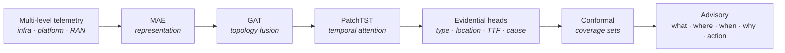

# autofm - System Design

### Predict network faults before they cause outages.

**Autonomous Fault Management for 5G Open RAN** · Team AFM_Ericsson · European AI Hackathon 2026

---

## Summary

A single fault in a virtualized Open RAN network does not stay in one place. A
host CPU throttling under a thermal spike degrades its containers, then the cells
they serve - surfacing minutes later as packet loss that a radio-only monitor
blames on the radio. By the time a reactive tool fires, the outage has happened.

**`autofm` turns fault management from reactive to predictive.** It reads
telemetry across all three deployment levels at once, learns a fault's signature
*as it builds*, and raises a calibrated advisory **before impact**:

> **what** will fail · **where** it originates · **when** · **why** (causal
> path) · **what to do**.

| Document | For |
|----------|-----|
| **This doc** | The design pitch: problem, approach, model, GPU scale, evaluation. |
| [`ARCHITECTURE.md`](ARCHITECTURE.md) | C4 architecture views and quality attributes. |
| [`DATASET_SPEC.md`](DATASET_SPEC.md) | Dataset overview - what it is and why it matters (short). |
| [`DATASET_REFERENCE.md`](DATASET_REFERENCE.md) | Full data schema, topology, labeling + ML pipeline contract. |

---

## What makes autofm different

| | Conventional monitoring | **autofm** |
|---|-------------------------|------------|
| **Timing** | Reactive - after the fault | **Predictive** - ahead of impact |
| **Scope** | Single level | **Multi-level** - infra + platform + RAN fused |
| **Output** | "An alarm occurred" | **What / where / when / why / action** |
| **Trust** | Binary alarm | **Calibrated uncertainty + coverage guarantee** |
| **Explainability** | Operator investigates | **Causal chain** from graph attention |
| **Scale** | Per-site rule tuning | **GPU-accelerated** across the fleet (4× A100, DDP) |

---

## The problem

Open RAN disaggregates the base station into containers on shared
infrastructure, so **one fault expresses itself across every level at once** -
and the symptom and the root cause live on different levels:

- **Infrastructure** - host (CPU, memory, temperature, power)
- **Platform** - CU / DU network-function containers
- **RAN** - cells, carriers, user-plane transport

A radio-only monitor sees the symptom (packet loss) and blames the radio - the
wrong layer. `autofm` observes all levels jointly and predicts the fault ahead
of impact, with its true origin.

---

## Approach

Multi-level telemetry flows through five specialized stages into a calibrated
advisory:

| Stage | Choice | Why |
|-------|--------|-----|
| Representation | Masked Autoencoder | Nonlinear cross-level coupling; reconstruction error = anomaly score |
| Topology fusion | Graph Attention Network | Propagates signal along the graph; attention = causal chain |
| Temporal model | PatchTST | Parallel, attention-based, efficient on long sequences |
| Classification | Evidential Deep Learning | Prediction **and** uncertainty in one pass |
| Calibration | Conformal Prediction | Distribution-free, guaranteed coverage |

Four heads share the backbone and produce the full advisory in one forward pass:
**fault type** (with uncertainty), **localization** (origin node), **TTF**
(quantile lead time), and **causal chain** (GAT attention trace). See
[`ARCHITECTURE.md`](ARCHITECTURE.md) for the component-level view.

---

## Product vision

One learning core, one analysis fabric, three management domains:

| Domain | Role | This release |
|--------|------|--------------|
| **FM** | Predict, localize, explain faults | Full predictive pipeline |
| **PM** | KPI impact + SLA breach risk | Advisory integration |
| **CM** | Rank corrective actions | Advisory integration |

Each domain publishes to a shared **Analysis Bus**; a **Correlation Engine**
fuses them into one ranked advisory. *Example:* FM predicts transport packet loss
on a link under `GNB001`; PM projects an SLA breach; CM proposes re-homing the
bearer → *"Re-home the user-plane bearer off the degrading link. Confidence ≈ 0.9."*

---

## GPU acceleration & scale

Fleet-scale fault prediction is a GPU problem - hundreds of cells, thousands of
counters, sampled every 15 minutes over months. The same code runs on a laptop
and scales to a multi-GPU node:

- **Distributed training** - the representation stage trains under PyTorch DDP
  across **4× A100** via `torchrun`; single-process fallback on CPU / Apple MPS.
- **Mixed precision** - AMP (fp16 Tensor Cores) and TF32, gated to CUDA so the
  laptop path is unaffected.
- **Measured, not assumed** - a benchmark times steady-state throughput
  (`cuda.synchronize`-bracketed) and reports scaling efficiency
  = throughputₙ / (N × throughput₁). NVTX ranges feed an NVIDIA Nsight timeline.

A CUDA driver/runtime preflight check surfaces version mismatches as clear
messages instead of opaque multi-rank NCCL failures. Details:
[`PROFILING.md`](PROFILING.md), [`ARCHITECTURE.md` §6-§7](ARCHITECTURE.md#6-deployment-view).

---

## Evaluation

**Leakage-safe by design.** Chronological 60 / 20 / 20 split (validation and test
strictly after training) plus a held-out conformal calibration slice. Alarms are
labels only, never features; a window is positive only if a fault *onsets* within
the horizon - genuine prediction, not detection. Full contract:
[`DATASET_REFERENCE.md` §10](DATASET_REFERENCE.md#10-feature--ml-pipeline-contract).

Because the task is imbalanced toward Normal, success is **macro-F1 / per-class
recall / PR-AUC**, not accuracy.

| Metric | Target |
|--------|--------|
| Fault-type macro-F1 | Materially above majority-class & linear baselines |
| Per-class recall | Balanced across fault classes |
| PR-AUC (fault vs. Normal) | High precision at useful recall |
| Localization top-k | Correct origin within top-k for most faults |
| TTF RMSE (ROPs) | Low error within the degradation ramp |
| Conformal coverage | At/above nominal (e.g. 95%) |
| Horizon curve (5→120 ROPs) | Graceful decay, useful at long lead |

---

## Delivery roadmap

| Milestone | Deliverable |
|-----------|-------------|
| **Foundation** | Multi-level pipeline; MAE + temporal classifier end to end |
| **Explainability & uncertainty** | GAT localization + causal chain; TTF head; evidential + conformal |
| **Advisory & scale** | FM/PM/CM correlation; multi-GPU training + benchmarking; horizon & ablation |

---

## Stack & structure

**Stack:** Python 3.14 · PyTorch (+ DDP) · PyTorch Geometric · scikit-learn ·
MAPIE · NumPy / Pandas / SciPy · NVIDIA Nsight. PyG and MAPIE are optional
accelerators with built-in fallbacks, so the system never fails on a missing
package.

**Structure:** `autofm/{data, model, advisory}` plus entry points
`pipeline · train_mae · bench · profile_dataset`. Full layout and C4 views:
[`ARCHITECTURE.md`](ARCHITECTURE.md).

---

## Glossary

**ROP** 15-min counter interval · **gNB** 5G base station · **MAE** masked
autoencoder · **GAT** graph attention network · **PatchTST** patch-based
Transformer · **Evidential DL** Dirichlet classifier giving a prediction +
uncertainty · **Conformal** distribution-free calibrated coverage sets ·
**TTF** time-to-failure · **DDP** PyTorch multi-GPU training · **AMP/TF32** GPU
mixed-precision on Ampere. Domain and schema detail:
[`DATASET_REFERENCE.md`](DATASET_REFERENCE.md).

---

**Team AFM_Ericsson** · European AI Hackathon 2026

